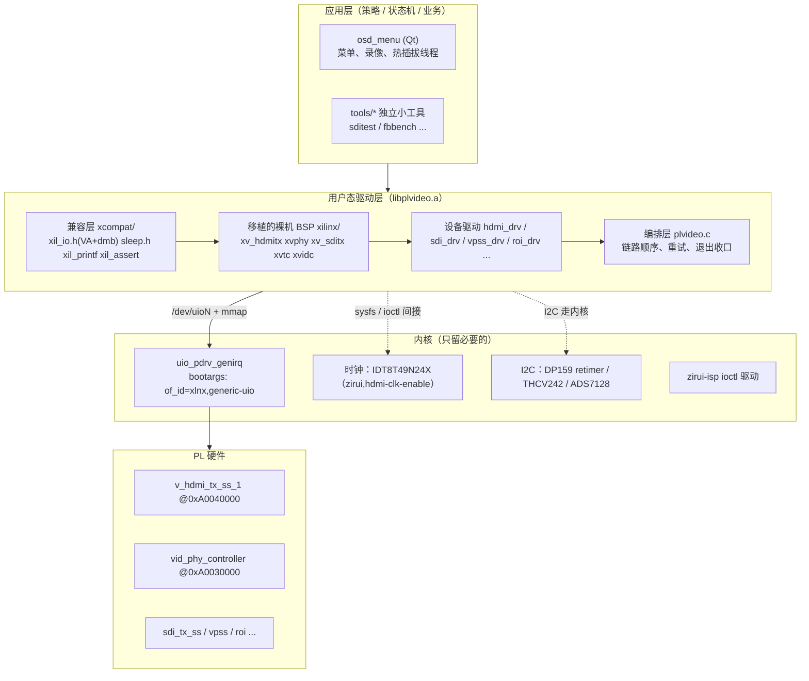
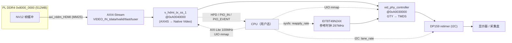
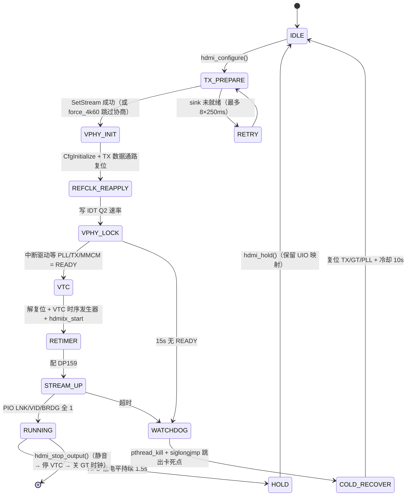
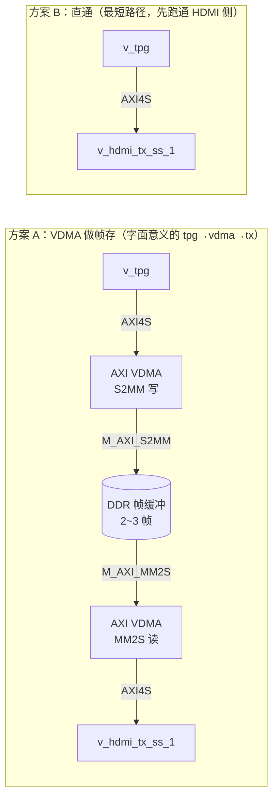
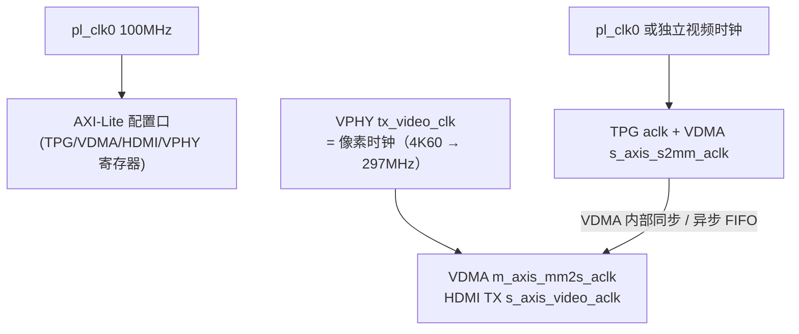
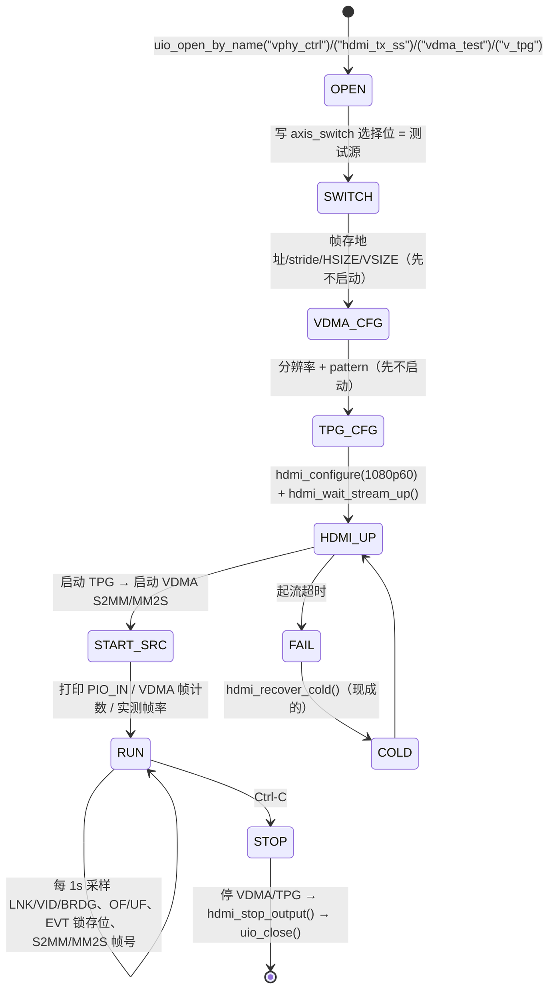

# ZynqMP UIO 架构分析（含 TPG → VDMA → HDMI TX 测试方案）

> 本文只作架构讨论与技术备忘，不属于任何工程仓库，不涉及工作目录内的代码改动。
> 文中事实来自对 `20_uio_petalinux` 下 `app/osd_menu/libplvideo`、`sys/petalinux` 设备树、
> `sys/vivado/bd/system.tcl` 的阅读，可能随工程演进失效，标注「待核实」处需回板确认。

---

## 1. 这套 UIO 架构的骨架：三层 + 三条契约



### 1.1 三条契约（「应用层配硬件」能成立的全部前提）

| 契约 | 实现 | 代码位置 |
|---|---|---|
| ① 寄存器窗口 | 设备树 UIO 节点 → `/dev/uioN` → `mmap` 出 VA；`Xil_Out32` 直接写 | `uio_util.c` 的 `uio_open_by_name()`；`xcompat/xil_io.h` |
| ② 中断 | `poll()` + `read()` 取事件计数，`write(1)` 解除屏蔽 | `uio_wait_irq()` / `uio_irq_unmask()` |
| ③ 缓冲内存 | `reserved-memory` no-map（PS 侧）或 PL DDR4（PL 侧） | `system-user.dtsi`；BD 的地址分配 |

**已实测的 UIO 设备**：`vphy_ctrl`（0xA0030000）、`hdmi_tx_ss`（0xA0040000，VTC 在 +0x10000）、
`sdi_tx_ss`、`vpss_scaler`。

**已知中断号**（板上核对过）：vphy 122（PL 90）、sdi 126（PL 94）、hdmi_tx 无中断（沿用轮询 PIO 的方案）。

### 1.2 「少量修改裸机 BSP」到底改了什么

- `xil_io.h`：standalone 下 `Xil_Out32` 是物理 MMIO；用户态下 BaseAddress 已经是 VA，因此改成
  `volatile` 解引用 + `dmb/dsb`。VPHY 的 DRP 是「命令写 + 紧跟状态轮询」，没有屏障会乱序，这点必须保留。
- `sleep.h` → `usleep`；`xil_printf.c` → `printf`；`xil_assert` → 打印；`xenv_standalone.h` 提供空环境。
- **BSP 主体（`xvphy.c`、`xv_hdmitx.c`、`xv_sditx.c`、`xvtc.c`、`xvidc.c`）一行未改。**

### 1.3 唯一的「嫁接点」：把 mmap 的 VA 喂给 BSP 配置表

```c
XV_HdmiTx_Config cfg = XV_HdmiTx_ConfigTable[0];   /* Vitis BSP 生成的默认配置 */
cfg.BaseAddress = (UINTPTR)hdmi->hdmi_uio.base;    /* 用 mmap 出来的 VA 覆盖 */
XV_HdmiTx_CfgInitialize(&hdmi->hdmitx, &cfg, cfg.BaseAddress);
```

```c
XVphy_Config cfg = XVphy_ConfigTable[0];
cfg.BaseAddr = (UINTPTR)hdmi->vphy_uio.base;
XVphy_Hdmi_CfgInitialize(&hdmi->vphy, VPHY_QUAD_ID, &cfg);
```

**模式总结**：保留 BSP 的 `_g.c` 配置表当默认值，只替换基址。
新增 IP 同理，不必去补 `xparameters.h`（该文件是从 Vitis BSP 整体拷来的，含大量 PS 外设定义）。

---

## 2. 现有 HDMI 链路的数据流



分工要点：**控制面走 UIO（用户态），但时钟芯片与 retimer 仍走内核**——
它们挂在 I2C / clock 子系统上，用户态直接碰会与内核抢。

内存布局（PS 侧，`reserved-memory` + `no-map`）：
- `0x68000000` UI RGBA，0x06000000
- `0x70000000` NV12 raw，0x03C00000
- `0x7A000000` NV12 processed，0x03C00000

PL 侧：`PL_DDR4` @ `0x80000000` / 512MB，供 `rd_hdmi`、`rd_sdi`、`vpss_osd`、`isp` 等 PL 主设备使用。

---

## 3. HDMI 起流状态机（`hdmi_bringup_phase`，现有实现）



`hdmi->bringup_phase` 挂在设备上，看门狗超时可直接打印卡在哪个阶段。
这个「阶段标记 + 看门狗 + siglongjmp 跳出」的模式值得在任何同类起流流程里照抄。

### 3.1 一个真实的 UIO 语义坑（已踩过）

起流等待循环与 VPHY 中断线程共用同一个 `uio_dev_t` 的同一个 fd 时：
两者被同一次事件 `poll` 唤醒，**先 `read()` 的取走事件，后 `read()` 的阻塞在 `read()` 里**；
而 `uio_pdrv_genirq` 在事件被取走后一直保持中断屏蔽，直到有人写 1 解除——下一次事件可能永不再来，
后一个 `read()` 永久卡死。表现是「重配停在参考时钟已重配之后再无任何输出，也不打失败日志」。

规避手段（现网已做）：起流期间停掉中断线程独占中断；`open` 带 `O_NONBLOCK`；
`read()` 返回 `EAGAIN` 视为「本轮无事件」而非错误。

---

## 4. 测试链路 TPG → VDMA → HDMI TX 怎么做

### 4.1 两种拓扑



建议：**两个都接，中间放 `axis_switch`（2:1）**，选择位由 UIO 写：
0 = 原 `rd_hdmi`（业务画面），1 = TPG/VDMA（测试画面）。
同一个 bitstream 既能跑业务又能跑测试，也顺带演示「应用层控制数据通路」。

### 4.2 时钟域（最容易翻车）



- **MM2S 侧必须与 HDMI 的 video clk 同源**，否则 `m_axis_mm2s` 与 TX 的 `s_axis_video` 跨时钟，桥 FIFO 会欠流（`UNDERFLOW`）。
- TPG / S2MM 侧可另用时钟，但写入带宽必须 ≥ 消费带宽，否则 MM2S 读空帧。
- 建议 **1080p60（148.5MHz）先跑通，再切 4K60**。

### 4.3 BD 改动清单

| # | 改动 | 说明 |
|---|---|---|
| 1 | 加 `v_tpg`（AXI4S 输出） | 输出接 VDMA `S_AXIS_S2MM` |
| 2 | 加 `axi_vdma`，开 **S2MM + MM2S 双通道**、帧存 3、帧同步 | 只开 MM2S 就没有「tpg 写」这一段 |
| 3 | `M_AXI_MM2S/S2MM` 挂到 PL DDR4 的 interconnect（`axi_interconnect_0` 加一个 Sxx 口） | PS 看不到 PL DDR4（`/dev/mem` 读不到），但不占 CMA、不抢 PS 带宽；要 CPU 可见则挂 PS HP 口 + reserved-memory（**待核实** interconnect 是否还有空余口） |
| 4 | 时钟/复位：`s_axis_video_aresetn` 走 `rst_ps8_0_96M`，AXI-Lite 走 `rst_100m`；MM2S 的 AXI4S 时钟接 `vid_phy_controller_0/tx_video_clk` | 与现有 `v_hdmi_tx_ss_1` 接法保持一致 |
| 5 | 加 `axis_switch` 做 VIDEO_IN 源选择（寄存器由 UIO 写） | 可选，强烈建议 |
| 6 | `assign_bd_address` 给新 IP 分配 `0xA00x_0000` 段（避开已用段），重新导出 XSA | 已用：0xA0020000、0xA0030000(vphy)、0xA0040000(hdmi_tx_ss +0x10000 VTC)、0xA00C0000、0xA0200000 |

### 4.4 设备树改动

```dts
/* system-user.dtsi 追加；bootargs 已有 uio_pdrv_genirq.of_id=xlnx,generic-uio，不用改 */
tpg@a0050000 {
    compatible = "xlnx,generic-uio";
    linux,uio-name = "v_tpg";
    reg = <0x0 0xa0050000 0x0 0x10000>;
};
vdma_test@a0060000 {
    compatible = "xlnx,generic-uio";
    linux,uio-name = "vdma_test";
    reg = <0x0 0xa0060000 0x0 0x10000>;
};
```

两个坑先避开：
- **一个 UIO 节点 = 一个 `/dev/uioN`**，且 `uio_util.c` 只映射 `map0`（第一段 reg）→ TPG 与 VDMA 分两个节点最省事。
- 缓冲若放 PS DDR，加一段 `reserved-memory` 且必须 `no-map`；用户态没有 `Xil_DCacheFlush` 的等价物，
  一致性要自己处理（非缓存映射 / `msync` / `__clear_cache`）。放 PL DDR4 则无此问题，但 CPU 读不到内容。

### 4.5 软件骨架

```
tools/tpg_vdma_hdmi/
  main.c          # 状态机 + 命令行
  tpg_drv.c/.h    # 新增：纯寄存器或移植 xtpg.c
  vdma_drv.c/.h   # 新增：移植 xaxivdma.c（推荐，别手写偏移）
  # 复用：libplvideo.a 里的 uio_util.o + hdmi_drv.o
```

注：`libplvideo/xilinx/` 目前**只有** `xv_hdmitx / xvphy / xv_hdmic / xv_sditx / xvtc / xvidc`，
**没有** `xaxivdma` / `xtpg`，需从 Vitis BSP 拷；`libplvideo/Makefile` 的 `LIB_SRCS` 追加两行即可。

主流程（数据源最后开）：



**绝不要先开数据源再起 HDMI**：TX 等 `stream_up` 时上游无数据，会先记一串 `UNDERFLOW`、
把锁存位弄脏，后面判断全是干扰。

### 4.6 验收指标

| 检查项 | 怎么看 |
|---|---|
| HDMI 链路起来 | `hdmi_dump_status()`：`LNK=1 VID=1 BRDG=1`、`UF=0 OF=0`、`PIO_EVENT` 锁存位全 0 |
| 数据确实来自 TPG | 改 TPG 的 pattern 寄存器（纯 UIO 写），画面立刻变 |
| VDMA 在跑 | 读 `S2MM_SR` / `MM2S_SR` 的帧计数，1 秒差值 = 帧率 |
| 帧率达标 | 1080p60 ≈ 60；4K60 ≈ 60（不足则先看 S2MM 侧是否喂不饱） |
| 观测链路可用 | 故意停 VDMA → 应看到 `UNDERFLOW` 被 EVT 记下（顺带验证观测手段本身） |

### 4.7 坑位清单（按踩坑成本排序）

1. **UIO 中断共享死锁**（见 3.1）：VDMA/TPG **别走中断**，轮询 `SR` 即可；
   真要用中断必须独立 `uio_dev_t` + 独立 fd，不能与 VPHY 共用。
2. **缓冲内存**：PL DDR4 上的缓冲 CPU 访问不到（不能 `devmem` 看），但不抢 PS 带宽；要 CPU 可见走 PS HP 口 + no-map。
3. **顺序**：HDMI 起流 → 再开 TPG/VDMA；停止时反向。
4. **时钟**：MM2S 的 AXI4S 时钟必须是 `tx_video_clk`；改分辨率时 VPHY 换频，VDMA 要跟着重配。
5. **带宽**：PL DDR4 上现有 `rd_hdmi`、`rd_sdi`、`vpss_osd`、`isp` 四路，4K60 再插一路很可能 over/underflow
   ——这既是风险，也是这套 EVT 观测最有用的场景。
6. **地址冲突**：新 UIO 的 `reg` 别与已用段重叠；一个节点只映射 `map0`。
7. **`xparameters.h`**：不含新 IP，用 `Xxx_ConfigTable[0]` + 覆盖 `BaseAddress` 绕开，别手改它。
