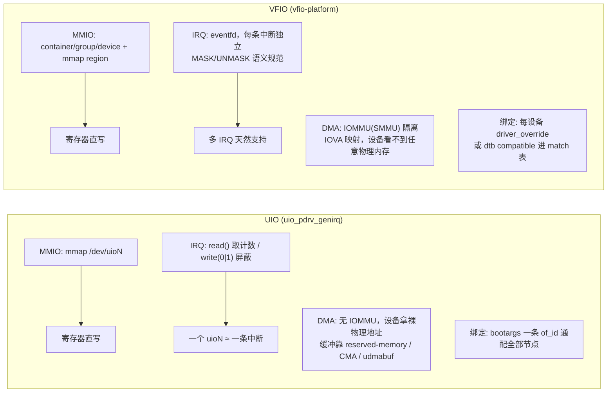
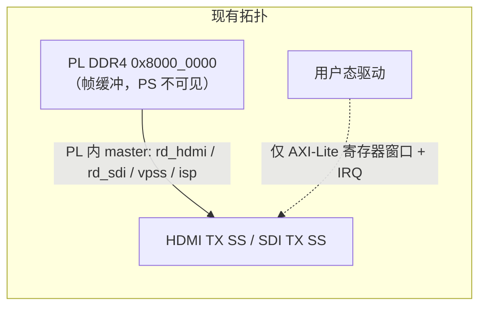
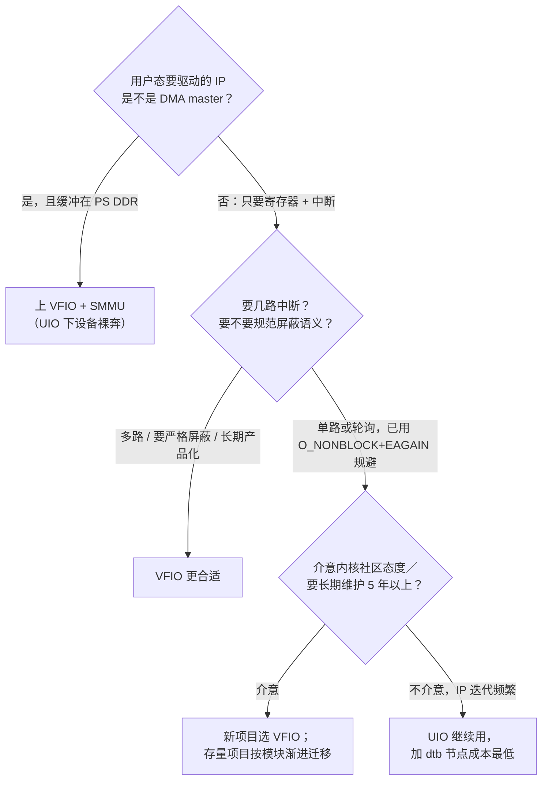

# UIO vs VFIO：在本项目语境下的选型讨论

> 触发：GitHub Copilot 提示「UIO 不如 VFIO」。本文给出我的判断、依据与边界条件。
> 只作技术讨论，不涉及工程改动。文中「待核实」项需回板或查内核配置确认。

---

## 0. 一句话结论

**主流意见（VFIO 优先）是对的，但它是通用建议；落到本项目当前的硬件拓扑上，UIO 的短板大部分没被触发，
而 VFIO 的代价（SMMU 与现有 PL DMA 共存、每个设备的绑定改造）是实打实的。**

分层结论：

| 设备类型 | 建议 | 理由 |
|---|---|---|
| **寄存器 + 中断型**（VPHY、HDMI TX SS、VTC、TPG、自研小 IP） | UIO 足够，不必迁 | 不产生 DMA，IOMMU 保护用不上；中断坑已有规避模式 |
| **DMA master 型**（AXI VDMA、自研读写 DMA，且缓冲在 PS DDR） | **VFIO + SMMU 才是正解** | 这是 UIO 的真正短板：无 IOMMU，设备拿到裸物理地址 |
| 需要多路独立中断 / 规范屏蔽语义 / 长期产品化维护 | VFIO 更稳 | UIO 的 `write(0/1)` 屏蔽语义很怪，多 IRQ 能力弱 |

---

## 1. 两者本质上差在哪（不是性能）

**性能零差异**：两者都是「mmap 出 VA + 用户态直接写寄存器」，没有内核中转，没有 ioctl 开销差别。
差异全部在 **安全隔离、中断语义、内核接受度、运维成本** 四项。

---

## 2. Copilot 说得对的部分（我不反驳）

1. **内核社区态度**：UIO 长期被视为「绕开写正规内核驱动的后门」，maintainer 明确不鼓励新代码使用它；
   UIO 仍在树内但基本处于维护状态。新项目默认选 VFIO 是更稳妥的工程判断。
2. **DMA 安全**：UIO 下设备 DMA 拿到的是真实物理地址，**没有任何 IOMMU 约束**。
   一个行为异常（或被误配）的 DMA IP 可以写坏任意内存——包括内核。这在有 PL DMA 的设计里不是理论风险。
3. **中断语义**：`read()` 取事件 + `write(0/1)` 控制屏蔽这套语义非常怪，而且**一个 `/dev/uioN` 只对应一条中断**。
   本文 01 里记录的那次「永久卡死」就是这套语义的直接产物；VFIO 用 per-IRQ 的 eventfd + 明确的 MASK/UNMASK，
   **从机制上消灭了这一类 bug**（不同等待者各自持有自己的 eventfd，不存在「事件被别人取走」）。
4. **可复位 / 热插拔 / 多设备管理**：VFIO 有 reset 抽象与更规范的设备生命周期。

---

## 3. 但落到本项目，大部分风险没被触发

这是我不建议「现在就迁」的核心理由。

### 3.1 现有 UIO 设备全是「寄存器 + 中断」型，不发生 CPU 侧 DMA

关键点：**CPU 并不给这些 DMA 分配地址**。帧缓冲地址在 BD 里就固定好了，PL 内的读 DMA 自己访问 PL DDR4。
UIO 映射的只是 AXI-Lite 寄存器窗口和一条中断线。也就是说：

> IOMMU 保护的主要目标（「别让设备乱写内存」）在这里已经由**拓扑**部分达成了——
> 设备根本不碰 PS 侧内存，也不经过 SMMU。

用 VFIO 换 UIO，对这些 IP 来说得到的是「更规范的中断」和「内核认可」，而不是「安全隔离的实质提升」。

### 3.2 全开 SMMU 对现有设计是风险项

ZynqMP 上有 ARM MMU-500（DTS 里通常是 `smmu@fd800000`，**待核实**）。一旦为 PL 主设备启用 SMMU：

- 每个 PL AXI master 需要正确的 **Stream ID / STE** 映射，配置不当会直接让 PL DMA 失效或异常；
- 现有四条 PL DMA 通路（rd_hdmi、rd_sdi、vpss_osd、isp）全部要重新验证；
- 它们现在的「裸地址直访」是**已经跑稳**的状态。

为了给寄存器型 IP 换一个更规范的中断机制，去动一个跑稳的 DMA 子系统——这笔账不划算。

### 3.3 运维成本：UIO 一条 bootarg vs VFIO 每设备绑定

- UIO：`uio_pdrv_genirq.of_id=xlnx,generic-uio` 一条 bootarg **通配所有节点**；
  加一个新 IP 只需在 dtb 里加一个节点。这个工程现在每次 BD 改动都要加 IP，这个便利性很值钱。
- VFIO-platform：通用设备需要 `driver_override`（`echo vfio-platform > .../driver_override`）或修改
  dtb 让 compatible 进 match 表；Xilinx PL IP 通常没有 reset 能力，还要处理
  `vfio_platform.reset_required=0` 这类摩擦。IP 越多，启动脚本/绑定流程越碎。

### 3.4 迁移成本本身不高，但收益也不高

真正需要重写的是 `uio_util.c` → `vfio_util.c`：打开 `/dev/vfio/vfio`、container/group/device、
mmap region、IRQ 走 eventfd。约 **300~500 行**。BSP 侧（`xvphy`、`xv_hdmitx`…）**零改动**——
它拿到的还是 VA，还是 `Xil_Out32`。

所以迁移不是「不可能」，而是「**花几百行 + 动 SMMU 风险，换来规范中断与社区认可**」。
对寄存器型 IP，我的评价是：**值得记在账上，不值得现在做。**

---

## 4. 什么时候必须换 VFIO（我的判据）

套到 01 篇的测试链路上：

- **TPG**：寄存器型（无 DMA）→ UIO 完全够。
- **VDMA**：**这个才是 UIO 的真正短板**。所以 01 篇里我建议把 VDMA 的 `M_AXI` 挂到 **PL DDR4 侧**而不是 PS HP 口
  ——那不只是「省带宽」，更是**刻意避开 UIO 无 IOMMU 的短板**：让它只碰 PL 侧内存，不进 PS 地址空间。
- 如果测试程序**必须**让 VDMA 用 PS DDR、且 CPU 还要读写帧内容，那我同意 Copilot：**这一段应该走 VFIO + SMMU**，
  或者退一步用 UIO + `udmabuf`/CMA 并接受「设备能写坏内存」这个前提。

---

## 5. 如果真要迁移，建议路径（渐进，不做大爆炸）

1. **抽象一层 `dev_access` 接口**：`{ map_reg, rd32, wr32, wait_irq, mask/unmask }`。
   现在实现一份 UIO 后端（`uio_util.c` 原样），将来加一份 VFIO 后端。上层驱动与 BSP 不动。
2. **先迁一个非关键 IP**（比如新增的 TPG）踩通 VFIO-platform 绑定、dtb、eventfd 全流程。
3. **DMA 设备单独决策**：确认 SMMU 与现有 PL DMA 能否共存（`smmu` 的 stream matching / bypass 配置），
   先在测试链路上验证，再决定要不要把业务 DMA 也纳进来。
4. **寄存器型老 IP 可以一直留在 UIO**，两者在一个系统里共存没有冲突。

---

## 6. 需要回板/查配置确认的点

- [ ] 内核是否开了 `CONFIG_VFIO`、`CONFIG_VFIO_PLATFORM`、`CONFIG_ARM_SMMU`（PetaLinux 默认可能都没开）
- [ ] ZynqMP DTS 里 `smmu` 节点地址与当前启用状态
- [ ] `axi_interconnect_0` 是否还有空余 S 口可挂 VDMA
- [ ] 现有 PL DMA 走 SMMU 时的 Stream ID 需求（会不会与 bypass 冲突）
- [ ] 目标内核版本对 `vfio-platform` 与 `reset_required` 的处理方式
