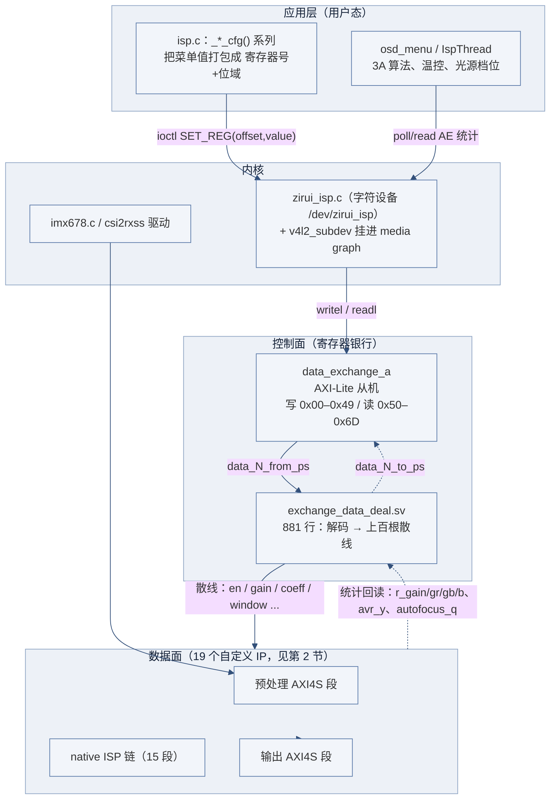
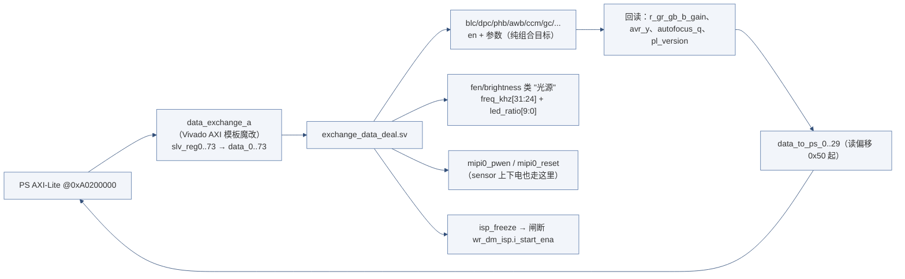
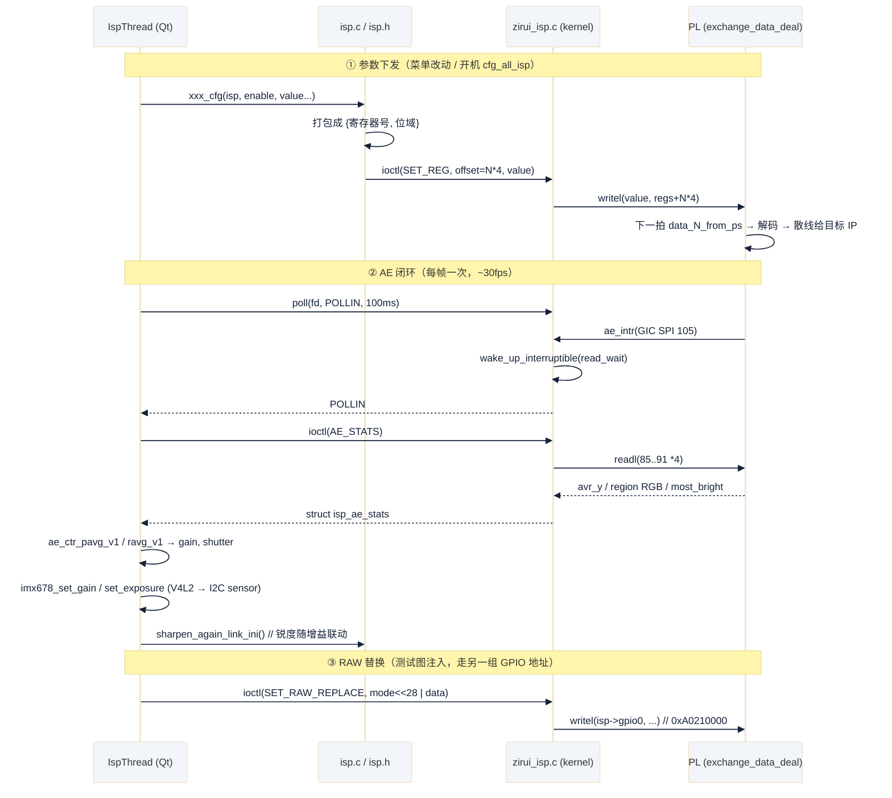
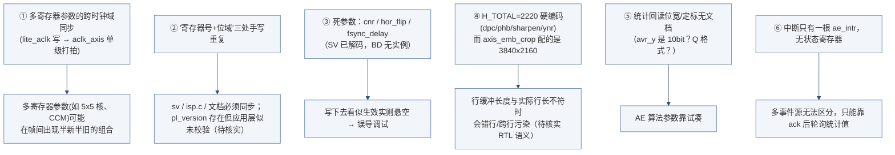

# `zirui_isp` 自定义 IP 群分析

> 素材来自 `20_uio_petalinux` 下的
> `sys/vivado/bd/system.tcl`（层次单元 `create_hier_cell_zirui_isp`，行 543–1170）、
> `sys/vivado/ip_repo/ip/**`（IP 源码与 `component.xml`）、
> `sys/petalinux/project-spec/meta-user/recipes-kernel/linux/linux-xlnx/0001-*.patch`（驱动 `drivers/media/platform/xilinx/zirui_isp.c`）、
> `.../device-tree/files/system-user.dtsi`、`app/osd_menu/src/{isp.c,ispthread.cpp,ae_ctrl.h}`。
>
> 本文是架构分析，不改任何工程文件。凡标「待核实」的结论均为从上文推断，需回设计者或 RTL 确认。

---

## 0. 一句话定性

`zirui_isp` 不是「一个 IP」，而是 **BD 里的一个层次单元（hier block）**，把 **19 个自定义 IP 串成一条定长流水线**，
再用 **一对「寄存器银行 IP」（`data_exchange_a` + `exchange_data_deal`）把上百个静态参数以散线（flat wire）方式扇出给各模块**。

它和 HDMI/SDI 那条 UIO 路线是**两套完全不同的访问哲学**：

| 对比项 | HDMI / VPHY / SDI | `zirui_isp` |
|---|---|---|
| 用户态可见方式 | UIO：`/dev/uioN` + `mmap` 后直写寄存器 | 内核字符设备 `/dev/zirui_isp` + `ioctl`（读写偏移） |
| 谁能拿到寄存器地址 | 用户态进程自己 | 只有内核（`readl/writel`），用户态只能传 offset/value |
| 参数布局知识在哪 | Xilinx BSP 结构体 + 头文件 | **三处手写重复**：`exchange_data_deal.sv`、`isp.c`、产品文档 |
| 中断 | UIO `read()` 取事件 | `poll()` + `read()` + GPIO ACK |
| 优点 | 改动快、无需动内核 | 多个进程共享安全、能给 V4L2 子设备挂接、地址不暴露给用户态 |

---

## 1. 全景：三层结构

---

## 2. 数据面：完整流水线

```mermaid
%%{init: {'theme':'base','themeVariables':{'background':'#FFFFFF','mainBkg':'#F2F5FA','nodeBorder':'#5B7AA9','lineColor':'#33507A','textColor':'#152238','clusterBkg':'#EDF1F7','clusterBorder':'#8FA5C4','titleColor':'#152238'}}}%%
flowchart LR
    IN["MIPI CSI-2 RX<br/>video_out (AXI4S)"] --> MB["mipi_bit_deal<br/>MIPI 位宽/解包"]
    MB --> EC["axis_emb_crop<br/>内嵌行裁剪<br/>DATA_WIDTH=20, 3840x2160"]
    EC --> RR["axis_raw_replace<br/>测试图/坏块替换<br/>replace_mode + fixed_data"]
    RR --> S2V["s2v_direct_ppc2<br/>AXI4S → native<br/>(vsync/hsync/valid/data)"]

    subgraph NATIVE["native ISP 链（同步像素流，逐级串）"]
        direction LR
        N1["dpc<br/>坏点校正"] --> N2["blc<br/>黑电平"] --> N3["phb<br/>伪彩抑制/高亮压制"] --> N4["awb<br/>白平衡增益"] --> N5["demonsaic<br/>去马赛克"] --> N6["ccm<br/>色彩校正矩阵"]
        N6 --> N8["gc<br/>γ"]
        N8 --> N9["rgb_dzc"] --> N10["rgb_btc"] --> N11["rgb_ctc"] --> N12["pro<br/>轮廓增强"] --> N13["rgb2yuv"] --> N14["sharpen<br/>5x5 卷积"] --> N15["ynr<br/>亮度降噪"] --> N16["sat<br/>饱和度"] --> N17["hue<br/>色调"] --> N18["edge_deal<br/>边缘遮黑(上下左右行数)"]
    end

    S2V --> N1
    N6 -.->|"旁路取数：统计分支"| TAP1["isp_native_ae<br/>AE 统计(全局/区域/最亮)"]
    N14 -.->|"旁路取数：清晰度评价值"| TAP2["autofocus<br/>g_total/g_valid/q"]

    N18 --> YC["xlslice y0/y1/u0/u1/v0/v1<br/>+ xlconcat → 24bit/2ppc"]
    YC --> S2VOUT["v_vid_in_axi4s<br/>native → AXI4S（Xilinx IP）"]
    S2VOUT --> CR["axis_crop<br/>WIDTH=64, 裁剪窗口由 45/46 号寄存器给"]
    CR --> Y2["axis_yuv444_yuv422_ppc2<br/>444 → 422"]
    Y2 --> MON["axis_passthrough_mon<br/>通透监测"]
    MON --> OUT["video_out → axis_data_fifo → wr_dm_isp → DDR"]

    style NATIVE fill:#FBFAF3,stroke:#C9B98A
    style TAP1 fill:#FDF1EC,stroke:#C58D6B
    style TAP2 fill:#FDF1EC,stroke:#C58D6B
```

链路要点：

- **入口/出口是 AXI4-Stream，中段是「native 像素流」（`vsync/hsync/valid/data`）**，两端靠
  `s2v_direct_ppc2`（入）与 `v_vid_in_axi4s`（出）转换。native 链一旦起流就是**纯组合级联**，没有 FIFO 缓冲，
  任一级反压/撕裂会直接传到下游。
- **两个旁路**：`isp_native_ae` 挂在 **CCM 之后**（拿到的是经白平衡+去马赛克+色彩校正后的 RGB，作为 AE 统计输入合理）；
  `autofocus` 挂在 **sharpen 之后**（用锐化后的高频做对焦评价函数合理）。
- **软硬件分工**：ISP 算法全在 PL 里固定流水；**3A（AE）的闭环在用户态**（`IspThread` 读统计 → 算增益/曝光 → 通过 V4L2 控制写 sensor），
  AWB 则在 PL 内闭环（`isp_native_awb` 自己出 `r/g/gr/gb_gain` 给 `blc/awb` 之前的增益级）。

---

## 3. 控制面：集中寄存器 + 散线扇出

### 3.1 两级结构

`data_exchange_a` 的地址空间（从其 AXI 模板 HDL 读出的）实测结论：

| 区域 | 地址索引 | 说明 |
|---|---|---|
| 写（配置） | `0x00`–`0x49`（即驱动里的 `N*4`，N=0..73） | 软件写 → `data_N_from_ps` 散线 |
| 读（状态/统计） | `0x50`–`0x6D`（N=80..109） | `data_to_ps_{0..29}` 回读，见下表 |

> 驱动里的 `ISP_REG_GLOBAL_AVR_Y = 85*4`、`MOST_BRIGHT = 86*4`、`REGION_AVR_Y/R/G/B = 88..91 *4`
> 正是 **0x55/0x56/0x58..0x5B** → `data_to_ps_5/6/8..11`，与 `exchange_data_deal.sv` 顶部
> `assign data_5_to_ps = global_avr_y;` 等完全对得上。**这套「读区从 0x50 起」的偏移关系在代码里没有任何注释，建议补。**

### 3.2 寄存器映射表（从 `exchange_data_deal.sv` 逐条解出）

**写（配置）**

| 号 | 位域 → 信号量 | 含义 |
|---|---|---|
| 1 | `[31]awb_en` `[27]dafault_hold_en` `[23]awb_is_on` | AWB 总开关 / 保持默认增益 / 开关位 |
| 2 | `[31:16]window_h_1` `[15:0]window_h_2` | AWB 统计窗（水平） |
| 3 | `[31:16]window_v_1` `[15:0]window_v_2` | AWB 统计窗（垂直） |
| 4–7 | `[25:0]` | `r/gr/gb/b_gain_default`（AWB 默认增益） |
| 8 | `[31]dpc_en` `[27:24]edge_width` `[15:0]limit` | 坏点校正 |
| 9 | `[31]mipi0_pwen` `[23]mipi0_reset` `[15]mipi1_pwen` `[7]mipi1_reset` | **sensor 上下电/复位**（不走 GPIO 子系统） |
| 10 | `[31]blc_en` `[7:0]sensor_gain` | 黑电平 |
| 11–19 | `[31]ccm_en` + 9×`[31:0]cc_00..cc_22` | CCM 3×3 |
| 20 | `[31]ae_en` `[23:16]ae_most_ratio` `[9:0]ae_limit` | AE 总参数 |
| 21 | `[31:24]m1` `[23:16]m2` `[15:8]m3` `[7:0]ae_low_limit` | AE 权重/下限 |
| 22–23 | 各 `[31:16]/[15:0]` | AE 统计窗 h1/h2、v1/v2 |
| 24 | `[31]gc_en` `[5:0]gc_switch` | γ |
| 25 | `[31]pro_en` `[15:0]beta_i` | 轮廓增强 |
| 26 | `[31]dzc_en` `[27:24]dzc_alpha` `[23]btc_en` `[19:16]btc_alpha` `[15]ctc_en` `[11:8]ctc_alpha` | **一个寄存器塞三组 RGB 调节** |
| 27 | `[31]saturation_en` `[25:16]s_level` `[15]hue_en` `[8:0]hue_level` | 饱和度 + 色调挤在一个寄存器 |
| 28 | `[31]sharpen_en` `[20:16]thr` `[11:0]alpha` | 锐化主参数 |
| 29–41 | 每寄存器装 **2 个** `[13:0]` | 5×5 卷积核共 25 个系数（最后一格溢出到 `[29:16]`） |
| 42 | `[31]ynr_en` `[25:16]ynr_alpha` `[15]cnr_en` `[6:0]cnr_alpha_i` | 降噪（**CNR 端 BD 里没实例 → 死参数**） |
| 43 | `[31]hor_flip` | 水平翻转（**BD 里无连接 → 死参数**） |
| 44 | `[7:0]fsync_delay_num` | 帧同步延时（**BD 里无连接 → 死参数**） |
| 45–46 | `[31:16]/[15:0]` ×4 | `axis_crop` 裁剪窗口（列低/列高/行低/行高） |
| 47 | `[31]phb_en` `[2:0]phb_alpha_idx` | 高亮压制 |
| 48 | `[31:24]up` `[23:16]down` `[15:8]left` `[7:0]right` | 边缘处理（遮挡行数/列数） |
| 49 | `[31:24]freq_khz` `[9:0]led_ratio` | 头端光源（手柄 LED），注意**极性反置**（应用层注释：关灯 = 写 100） |
| 50 | `[24:16]phb_k_256` `[10:0]dr_limit_1` | PHB 参数 |
| 51 | `[26:16]dr_limit_2` `[10:0]dr_limit_3` | PHB 参数 |
| 52 | `[9:0]ynr_t` | 降噪阈值（**与 42 号分离**，容易漏写） |
| 53 | `[31]7x7_en` `[23:16]mean_alpha_1` `[15]5x5_en` `[7:0]mean_alpha_2` | 锐化前置均值滤波 |
| 54 | `[31:24]freq_khz` `[9:0]led_ratio` | 大灯 |
| 55 | `[31:24]freq_khz` `[9:0]led_ratio` | 系统风扇（下限 30% 由软件保证） |
| 56 | `[0]isp_freeze` | 冻结 ISP 写回（**只取 bit0**，不能用上面那套 `[31:24]` 编码） |
| 57–69 | 已连到 `exchange_data_deal` 但 SV 内未解码 | 预留 |

**读（状态）**

| 号 | 内容 |
|---|---|
| 80 | `pl_version`（由常量 `ISP_VERSION = 0x00000006` 给出） |
| 81–84 | AWB 实际 `r/gr/gb/b_gain` |
| 85 | 全局平均 Y |
| 86 | 最亮区平均 Y |
| 87 | `vdma_delay`（**在 BD 里被 `xlconstant_0 = 0` 绑死**，读出来恒 0） |
| 88 | 区域平均 Y |
| 89–91 | 区域平均 R / G / B |
| 92 | `autofocus_q`（对焦评价值） |

---

## 4. 软件路径（一次参数下发与一次 AE 闭环）

注意点：

- **另一个地址区间 `gpio0` @ `0xA0210000` / `gpio_ack` @ `0xA0220000`** 由同一个 platform 设备持有
  （`reg-names = "isp","gpio0","gpio_ack"`），分别用于 RAW 替换注入和中断应答（写 1 再写 0）。
- 驱动同时注册为 **v4l2_subdev**，并向 media graph 抛 `V4L2_EVENT_ZIRUI_ISP_AE` 事件
  （`ae_ctrl.h` 里 `V4L2_EVENT_PRIVATE_START+1`）——即**同一件事有两条通知通道**（chardev poll / V4L2 event），
  目前应用层走的是 chardev 那条。
- `ispthread.cpp:388` 那段注释已经记录过一次真实事故：`poll` 超时不判 → 落到阻塞的 `read()` → 永久卡死。
  这与 01 篇里 HDMI UIO 的「共享 fd 事件被抢」是**同一类模式**（「等事件 + 取数据」分离时要自带超时）。

---

## 5. 设计评价

### 做得好的地方

1. **拆分粒度合适**：一个算法一个 IP，`vsync/hsync/valid/data` 接口统一，**链路上插拔一个模块（+ 对应解码）成本可控**。
2. **参数与数据流彻底分离**：所有静态参数走散线、配合 `[31]enable` 位；改参数不影响流控，
   每个模块都能独立旁路，方便逐段定位画质问题。
3. **链路自带旁路取数**：AE 统计与对焦评价值直接从链路中间就近取样，不额外占 DMA 带宽。
4. **ISP 冻结位做得干净**：一个 bit 关闸写 DMA，比「停 ISP 时钟」更安全。
5. **和 cdev 一起做 v4l2_subdev**，为将来走标准 media pipeline 留了口子。

### 风险与改进建议（按我建议的优先级）

逐条说明：

1. **跨时钟域的一致性（我认为这是最值得先看的点）**
   `data_N_from_ps` 是在 `lite_aclk`（AXI-Lite）域更新的组合线，`exchange_data_deal.sv` 里用
   `always@(posedge aclk)`（即 **视频时钟 `aclk_axis`**）采样，且**只是单级打拍**（`data_N_d <= data_N_from_ps` 之后再解位域）。
   对单比特使能尚可，**对多寄存器组合参数（5×5 卷积核占 13 个寄存器、CCM 占 10 个、AWB 窗 4 个）就是隐患**：
   不同寄存器可能在不同帧被采样生效，中间会出现「半个新核 + 半个旧核」的帧；更极端情况下单个寄存器内部不同 bit
   也会有亚稳态收敛不一致。
   建议：**影子寄存器 + 一次写触发**（例如一个 APPLY 寄存器或写 NV 序列），或至少把多寄存器参数先在
   `lite_aclk` 域打包成一个向量，再做两级同步/握手。

2. **寄存器协定没有单一事实来源**
   `exchange_data_deal.sv`、`isp.c` 的 `*_cfg()`、README/菜单表三处各写一遍位域。建议用一个
   `.h`/`.json` 生成 SV 的 `assign` 与 C 的 `#define`（哪怕用脚本从一张表生成两边）。**尤其第 3 节这张表
   目前没有任何地方完整写过**，本文可当草稿。

3. **死参数**：`cnr_en/cnr_alpha_i`、`hor_flip`、`fsync_delay_num` 在 SV 里被解码（`data_42/43/44`），
   但 BD 里对应的 `isp_native_cnr_0` / `native_hor_flip_0` / `fsync_delay_0` **均未实例化**（IP 仓库里有这些核）。
   也就是写了会生效地更新一组没人连的寄存器。建议要么接上，要么删以免误导。

4. **`H_TOTAL = 2220` vs `3840×2160`**：`dpc/phb/sharpen/ynr` 四个需要行缓冲的 IP 都硬配了 2220
   （这是 1080p 的行长量级），而 `axis_emb_crop` 与 `awb` 配的是 3840×2160。
   **待核实**：这四个 IP 的 `H_TOTAL` 语义到底是「行长」还是「最大行长上限」；若是前者，在 4K 直通时必然错行。
   如果答案是「上限」，那 4K 需要改成 ≥3840。

5. **回读统计缺少文档**：驱动暴露的 `global_avr_y` 等是 PL 给的 10bit 值，其**定标（是否乘 4 / 是否均值已除点数）**
   直接决定 `ae_ctr_target_y` 的量纲，`ae_ctrl.h` 里 `MIN_GAIN/MAX_GAIN` 也是示例值。建议一行注释明确单位。

6. **单一中断 + GPIO ACK**：目前 `ae_intr` 只由 `isp_native_ae` 产生。将来若加「ISP 内部错误/溢出」等事件，
   需要扩充状态寄存器，而不是再加中断线。

### 与 UIO 方案的取舍（小结）

- 现在这套 chardev 方式的**好处**：多个进程可以安全地共存/互斥访问同一组寄存器，且用户态不知道物理地址。
- **代价**：每个新参数要动 5 处（`sv` 解码 + `component.xml` 端口 + BD 连线 + 驱动（一般不用动）+ `isp.c`），
  而 UIO 方案通常只需要改 UBO（改基址 + 头文件偏移），甚至不必重编译内核。
- **折中建议**：维持 chardev/ioctl 边界，但把 `exchange_data_deal.sv` 的解码表**搬出 RTL**，改成
  「PS 写 raw 寄存器 + PL 侧一个通用 index/data 影子寄存器阵列」。这样新增参数只改软件，PL 侧一次定型。

---

## 6. 待核实清单

- [ ] `lite_aclk`（100MHz?）与 `aclk_axis`（300MHz?）的实际频率，以及 `data_N_from_ps` 跨域是否只有一级同步。
- [ ] `dpc/phb/sharpen/ynr` 的 `H_TOTAL=2220` 语义；4K 输入下是否够用。
- [ ] 读区为什么从 `0x50`(80) 开始、为什么中间断档（87=常量 0）——是否为历史遗留。
- [ ] `cnr / hor_flip / fsync_delay` 是准备接但没接，还是已废弃。
- [ ] `pl_version = 6` 与 IP 版本号（`zirui_isp_wrapper` tag `isp-freeze-v1.0`）的对应关系；应用层是否做了版本校验。
- [ ] 各统计量的位宽/定标（尤其 `region_avr_*` 是单区还是两区合成）。
- [ ] `head_led`（49 号）极性反置是否硬件层面无法统一——应用层现在靠写 100 表示关灯。
- [ ] `axis_passthrough_mon` 与 `vdma_delay` 是否有引出价值的监测数据（现在 `vdma_delay` 被常量 0 绑死）。
