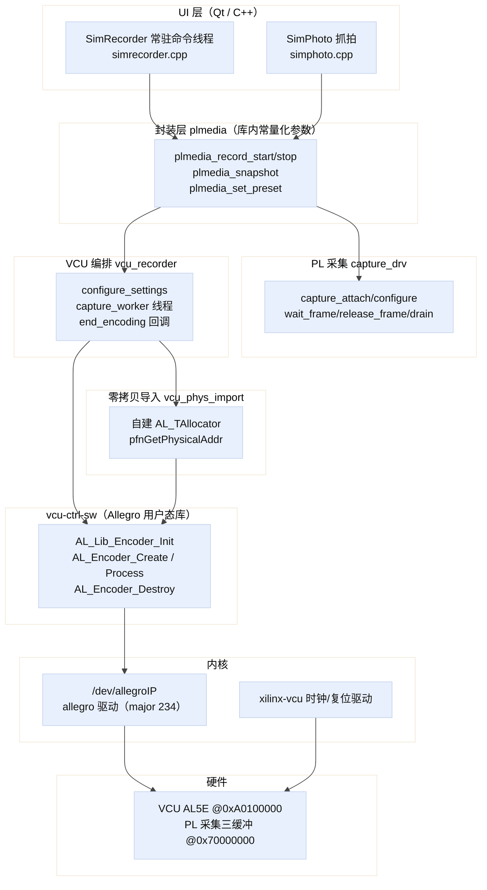
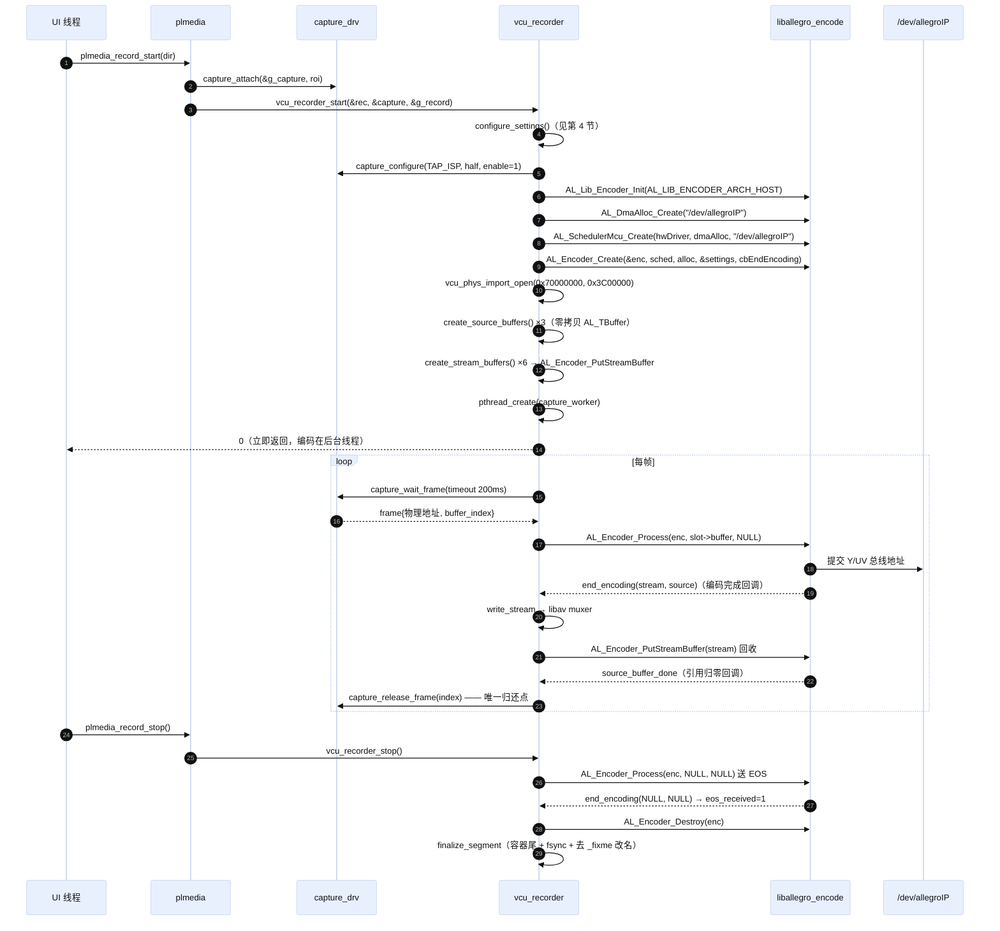
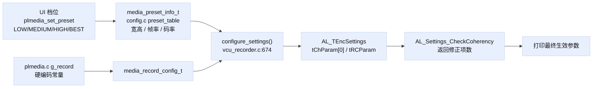
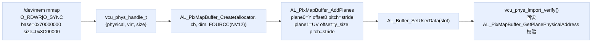
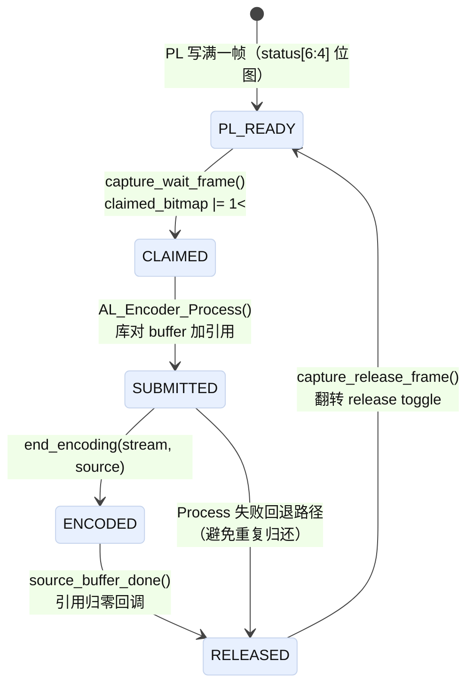
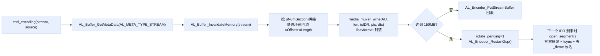

# 04 · osd_menu 的 VCU 调用链与参数设置

> 分析对象：`20_uio_petalinux/app/osd_menu`（`libplvideo/vcu_recorder.c`、`vcu_phys_import.c`、`media_muxer.c`、`plmedia.c`、`capture_drv.c`）
> 结论一句话：**本项目不走 GStreamer / OMX / V4L2 编码，而是直接在用户态调用 Xilinx `vcu-ctrl-sw`（Allegro）的 `AL_*` 底层编码 API，配合自写的 allocator 把 PL 的 DDR 物理地址零拷贝导入编码器。**

---

## 1. 软件栈分层



板端实测（ssh 到 192.168.1.100）：

| 项 | 实测值 |
|---|---|
| `/dev/allegroIP` | `crw-rw---- root:video 234, 0` |
| `liballegro_encode.so` | `0.32.0`（2022.2 的 vcu-ctrl-sw） |
| 内核日志 | `xilinx-vcu a0140000.vcu: could not find xlnx,vcu-settings: trying direct register access` |
| 设备树 | `vcu@a0100000`，`encoder = ".../vcu@a0100000/al5e@a0100000"` |
| SDK 头文件 | `$(SDKTARGETSYSROOT)/usr/include/vcu-ctrl-sw/include` |

关键点：**内核里没有任何"编码器驱动"在做编码**，只有 allegro 的 IPC/寄存器接口驱动 + `xilinx-vcu` 的时钟/复位；真正的编码调度、码率控制、参考帧管理全在用户态 `liballegro_encode.so` 里。

---

## 2. 完整调用时序（一次录像）



---

## 3. 底层 `AL_*` 接口清单（按调用顺序）

| # | 接口 | 位置 | 作用 / 注意 |
|---|---|---|---|
| 1 | `AL_Lib_Encoder_Init(AL_LIB_ENCODER_ARCH_HOST)` | `vcu_recorder.c:1049` | 全局初始化，`AL_LIB_ENCODER_ARCH_HOST` 表示由 APU 上的 MCU 调度器驱动硬件 |
| 2 | `AL_Settings_SetDefaults(&settings)` | `:685` | 必须先拿默认值，再改字段 |
| 3 | `AL_Settings_SetDefaultParam(&settings)` | `:719` | 按已填字段补齐派生参数 |
| 4 | `AL_Settings_CheckCoherency(&settings, chParam, FOURCC(NV12), stderr)` | `:720` | **返回值 >0 = 自动修正了几项**，代码会打印修正数 |
| 5 | `AL_Settings_CheckValidity(&settings, chParam, stderr)` | `:724` | 硬性合法性检查，非 0 即失败 |
| 6 | `AL_DmaAlloc_Create("/dev/allegroIP")` | `:1054` | 编码器内部 DMA 内存分配器（码流缓冲用） |
| 7 | `AL_SchedulerMcu_Create(AL_GetHardwareDriver(), dmaAlloc, "/dev/allegroIP")` | `:1057` | MCU 调度器，绑定同一设备节点 |
| 8 | `AL_Encoder_Create(&enc, sched, alloc, &settings, AL_CB_EndEncoding)` | `:1063` | 创建编码器实例并注册回调 |
| 9 | `AL_Buffer_Create_And_AllocateNamed` + `AL_StreamMetaData_Create(AL_MAX_SECTION)` + `AL_Encoder_PutStreamBuffer` | `:761~774` | 创建 6 个码流输出缓冲并交给编码器 |
| 10 | `AL_PixMapBuffer_Create` / `AL_PixMapBuffer_AddPlanes` | `vcu_phys_import.c:217/228` | 自建零拷贝源帧（见第 5 节） |
| 11 | `AL_Encoder_Process(enc, srcBuf, NULL)` | `:884` | 提交一帧；第三个参数 `AL_TBuffer *stream` 传 NULL = 让库自己从池里取 |
| 12 | `AL_Encoder_RestartGop(enc)` | `:611` | 请求下一帧强制 IDR（分包切点用） |
| 13 | `AL_Encoder_Process(enc, NULL, NULL)` | `:1126` | 送 EOS |
| 14 | `AL_Encoder_Destroy(enc)` | `:970/1154` | 销毁前会释放它仍持有的源帧与码流缓冲 |
| 15 | `AL_Buffer_InvalidateMemory(buf)` | `:359/527` | **VCU/PL 是 DMA 写、CPU 读，读前必须使 cache 失效** |
| 16 | `AL_IEncScheduler_Destroy` / `AL_Allocator_Destroy` / `AL_Lib_Encoder_DeInit` | `:983~988` | 逆序释放 |

---

## 4. 参数是怎么设置的

### 4.1 参数来源：三层映射



### 4.2 预设表（`libplvideo/config.c:12`）

| 档位 | 分辨率 | 帧率 | 码率 |
|---|---|---|---|
| LOW | 1920×1080 | 30 | 12600 kbps |
| MEDIUM | 1920×1080 | 30 | 19200 kbps |
| HIGH | 1920×1080 | 30 | 22900 kbps |
| BEST | 3840×2160 | 30 | 49900 kbps |

### 4.3 `media_record_config_t` 固化值（`plmedia.c:55`）

| 字段 | 值 | 说明 |
|---|---|---|
| preset | `MEDIA_PRESET_BEST` | 默认 4K |
| codec | `MEDIA_CODEC_H265` | H.265 Main |
| container | `MEDIA_CONTAINER_MP4` | mp4 |
| input_format | `MEDIA_PIXFMT_NV12` | 唯一支持 |
| gop_mode | `MEDIA_GOP_LOW_DELAY_P` | → `AL_GOP_MODE_LOW_DELAY_P` |
| gop / idr_interval | 30 / 30 | 每秒一个 IDR |
| b_frames | 0 | 无 B 帧，DTS 单调 |
| **ref_frames** | **1** | **只有 3 块零拷贝输入 buffer，实测 2 参考帧会把 4K 压到 26fps** |
| entropy | `MEDIA_ENTROPY_CABAC` | → `AL_MODE_CABAC` |
| level | `"auto"` | H.264→5.2、H.265→5.1（`parse_level`，`:636`） |
| tier | `MEDIA_TIER_HIGH` | 仅 H.265 有效 |
| segment_mode / size | `MEDIA_SEGMENT_SIZE` / 150 MB | 4K 最高档约 24 秒一段，避开 FAT32 4GB |
| tap | `MEDIA_TAP_RAW` | → `CAPTURE_TAP_ISP`，采集点固定在 ISP 输出 |

### 4.4 字段落到 `AL_*` 的映射表（`configure_settings()`，`vcu_recorder.c:674~744`）

| `AL_TEncChanParam` 字段 | 赋值 | 来源 |
|---|---|---|
| `uEncWidth` / `uEncHeight` | preset 宽高 | preset |
| `uSrcWidth` / `uSrcHeight` | 同上（不缩放） | preset |
| `ePicFormat` | `AL_420_8BITS` | 固定 |
| `uSrcBitDepth` | 8 | 固定 |
| `eSrcMode` | `AL_SRC_RASTER` | 帧式输入（非 tile） |
| `eProfile` | `AL_PROFILE_AVC_MAIN` / `AL_PROFILE_HEVC_MAIN` | codec |
| `uLevel` | `parse_level()`（×10 存整数） | level 字符串 |
| `uTier` | 0/1 | H.265 + tier=high |
| `eEntropyMode` | `AL_MODE_CABAC` / `AL_MODE_CAVLC` | entropy |
| `tGopParam.eMode` | `AL_GOP_MODE_LOW_DELAY_P/B`、`PYRAMIDAL`、`DEFAULT` | gop_mode |
| `tGopParam.uGopLength` | gop | |
| `tGopParam.uFreqIDR` | idr_interval | |
| `tGopParam.uNumB` | b_frames | |
| `uPpsParam`（`AL_SET_PPS_NUM_ACT_REF_L0`） | ref_frames | 活跃参考帧数 |

| `AL_TRCParam` 字段 | 赋值 |
|---|---|
| `eRCMode` | `AL_RC_CBR`（**固定 CBR**，想改 VBR/CQV 要在这里动） |
| `uTargetBitRate` | `bitrate_kbps * 1000` |
| `uMaxBitRate` | 与 target 相同 |
| `uFrameRate` / `uClkRatio` | `30` / `1000`（即 30000/1000 = 30.000 fps） |

> 想加参数，唯一正确的姿势：**加 `media_record_config_t` 字段 → 在 `configure_settings()` 里赋给对应 `AL_` 字段 → 让 `CheckCoherency` 兜底**，不要在别处直接改 `settings`。

---

## 5. 零拷贝：为什么必须自己写 allocator

`vcu_phys_import.c` 的存在理由写在文件头：

```c
/* 不能使用 AL_Buffer_WrapData()：它使用的 wrapper allocator 没有
 * pfnGetPhysicalAddr，编码器最终会得到物理地址 0。 */
```



- vtable 只提供 `pfnGetVirtualAddr` / `pfnGetPhysicalAddr` / `pfnFree`，`pfnAlloc` 直接 `ENOTSUP`（不分配内存，只翻译地址）。
- `pfnSyncForCpu/ForDevice` 是空函数：`/dev/mem` 以 `O_SYNC` 映射，CPU 不缓存这段。
- **32 位 `AL_PADDR` 限制**（2022.2）：`physical_base` 必须 < 4 GB 且整段落在 4 GB 内，否则返回 `EOVERFLOW`（`vcu_phys_import.c:136`）。当前 `0x70000000` 满足。
- `AL_PixMapBuffer_GetPlanePhysicalAddress` 没有安装到 sysroot 头文件里，代码在 `vcu_phys_import.c:26` **手工补声明**（符号由 `liballegro_encode` 导出）。这是个隐藏依赖：升级 vcu-ctrl-sw 时要确认它还在。

---

## 6. 帧所有权状态机（最容易写错的地方）



铁律（代码里的注释即原话）：

1. `capture_release_frame()` **只能在引用归零回调 `source_buffer_done()` 里调用**（`vcu_recorder.c:578`），提前归还会让 VCU 读到被 PL 覆盖的数据。
2. `AL_Encoder_Process()` 失败时可能已经加了引用 → 用 `slot->submitted` 标志判断是否还要手动归还，避免 double-release（`:884~901`）。
3. 停止时必须先 `destroying=1` + `AL_Encoder_Destroy()`，**等它不再 DMA 之后**才允许兜底释放没收到回调的帧（`:1150~1166`）。
4. 收尾还要 `capture_drain(capture, 50)`，归还 worker 停领后 PL 仍在途的一帧，否则**下次启动必然 EBUSY**（`:1171`）。

---

## 7. PL 采集侧的参数（不是 VCU 但要一起配）

`capture_drv.c` 头部注释即寄存器定义（`0xa00a0000`，走 ROI/控制 GPIO 通道）：

| 通道 | 位 | 含义 |
|---|---|---|
| 控制 | `[6]` | 采集使能 |
| 控制 | `[7]` | 2 倍降采样 |
| 控制 | `[9:8]` | 采样点：0=ISP，1=缩放后，2=OSD 后 |
| 控制 | `[12:10]` | PS 释放的缓冲区编号 |
| 控制 | `[13]` | PS 释放事件翻转位 |
| 状态 | `[0]` / `[3:1]` | PL 完成帧翻转位 / 最近完成编号 |
| 状态 | `[6:4]` | 三缓冲可读位图 |
| 状态 | `[7]` | PL/DataMover 错误 |
| 状态 | `[31:8]` | 完成帧序号低 24 位 |

常量（`capture_drv.c:45`）：

| 常量 | 值 |
|---|---|
| `CAPTURE_RAW_BASE` | `0x70000000` |
| `CAPTURE_PROCESSED_BASE` | `0x7a000000` |
| `CAPTURE_BUFFER_STRIDE` | `0x01400000`（20 MB/帧，4K NV12 约 12.4 MB，留足余量） |
| `CAPTURE_BUFFER_COUNT` | 3 |

**分辨率不是 VCU 缩放来的，是 PL 降采样位决定的**：

```c
half = preset->width == 1920 && preset->height == 1080;   /* vcu_recorder.c:1031 */
capture_configure(capture, tap, half, 1);
```

所以 1080p 三档是「PL 取 raw 点 + 2 倍降采样 → 1920×1080 NV12 → VCU 无缩放编码」，4K 档是 `half=0`。**VCU 侧 `uSrcWidth == uEncWidth` 永远成立**，它只编码不缩放。

---

## 8. 输出码流 → 容器



- 时间戳：PL 已按 30 Hz 选帧，`b_frames==0` 或 low-delay 时 **PTS=DTS=连续提交序号**（`:417~422`）；否则 DTS 用输出序号。
- 分包只在 **IDR 处**切：`key_frame` 用 `AL_SECTION_SYNC_FLAG` 判断（`:366`）。
- `_fixme` 后缀机制：写入中带后缀，`fflush+fsync` 成功后才 `rename` 去掉；断电残留文件可识别（`finalize_segment()`，`:263`）。

---

## 9. 抓拍（不走 VCU 编码）

| 场景 | 路径 |
|---|---|
| 未录像 | `snapshot_capture_once()`：独占一次 PL 采集 → memcpy → 立即归还 → libjpeg/BMP 同步落盘 |
| 录像中 | `vcu_recorder_request_snapshot()` 置 pending → worker 在下一帧 `AL_Buffer_InvalidateMemory` 后 memcpy 到独立缓冲 → 分离线程压缩 → `wait_snapshot(5s)` 等落盘 |

约束（`vcu_recorder.c:1253`）：抓拍 tap 必须与录像 tap 相同，且 4K 抓拍不能来自 1080p 录像流，否则 `ENOTSUP`。JPEG 质量随档位（70/80/90/90，`plmedia.c:43`）。

---

## 10. 构建与链接

`libplvideo/Makefile`：

```make
VCU_CPPFLAGS ?= -I$(SDKTARGETSYSROOT)/usr/include/vcu-ctrl-sw/include
VCU_SRCS := vcu_phys_import.c media_muxer.c media_disk.c snapshot_writer.c \
            vcu_recorder.c plmedia.c
%.vcu.o: %.c
	$(CC) $(CFLAGS) $(VCU_CPPFLAGS) -c -o $@ $<
```

`osd_menu.pro`：

```qmake
LIBS += -lallegro_encode -lavformat -lavcodec -lavutil -ljpeg
```

- VCU 模块用独立的 `.vcu.o` 规则（只多一个头文件搜索路径），`HOST=1` 时整组跳过（本地没有 allegro 头文件）。
- 目标板运行时依赖：`liballegro_encode.so.0`、`libav*`、内核 allegro 驱动提供的 `/dev/allegroIP`。

---

## 11. 已知坑位清单

| 现象 | 根因 | 位置/处理 |
|---|---|---|
| 每个新进程首次录像必失败 `EBUSY` | `CTRL` bit6 残留（上次进程退出没清），老代码直接判忙 | 现改为 `capture_recover_stale()` 接管恢复；README:243 |
| 编码器拿到物理地址 0 | 用了 `AL_Buffer_WrapData()`（无 `pfnGetPhysicalAddr`） | 必须走 `vcu_phys_import` |
| 4K 只有 26 fps | `ref_frames=2` 占满三缓冲 | 固定 `ref_frames=1`（`plmedia.c:66` 注释） |
| CPU 读到旧像素 | VCU/PL 是 DMA 写，CPU cache 未失效 | 读前 `AL_Buffer_InvalidateMemory` |
| EOS 卡死 | 未收 EOS 回调 | 10 s 超时兜底 + 先 Destroy 再兜底归还（`:1128~1156`） |
| 盘满报成 EIO | libav `avio` 有缓冲，写失败延迟且被统一成 EIO | 每 30 帧主动 `media_disk_reserve(32MB)`，提前报 `ENOSPC` |
| 拔盘后文件不见 | 目录项还在 page cache | rename 后 `fsync` 目录（失败只告警） |
| 升级 VCU 控制库后编不出物理地址 | 手工声明的 `AL_PixMapBuffer_GetPlanePhysicalAddress` 可能变 | `vcu_phys_import.c:26` |

---

## 12. 要改参数时的推荐步骤

1. **只改档位/码率** → 改 `config.c` 的 `preset_table`，不改代码结构。
2. **改编码行为（GOP/B 帧/参考帧/熵编码/码控模式）** → 改 `plmedia.c` 的 `g_record`，并在 `configure_settings()` 加对应 `AL_` 赋值。
3. **改码控模式为 VBR/CQV** → 需同时放开 `eRCMode`、`uMaxBitRate`，并确认 `CheckCoherency` 的修正项，看打印的「自动修正了 N 项」。
4. **改分辨率/帧率** → 同时核对：PL 降采样位（`half`）、preset 表、`uClkRatio`、PL 三缓冲 stride 是否够放（当前 20 MB/帧）。
5. 任何改动后用日志行校验（`vcu_recorder.c:726` 会打印最终生效的 `实际编码参数`，含 GOP/IDR/B/Ref/Level/Tier），**以它为准，不是以你填的值为准**。
